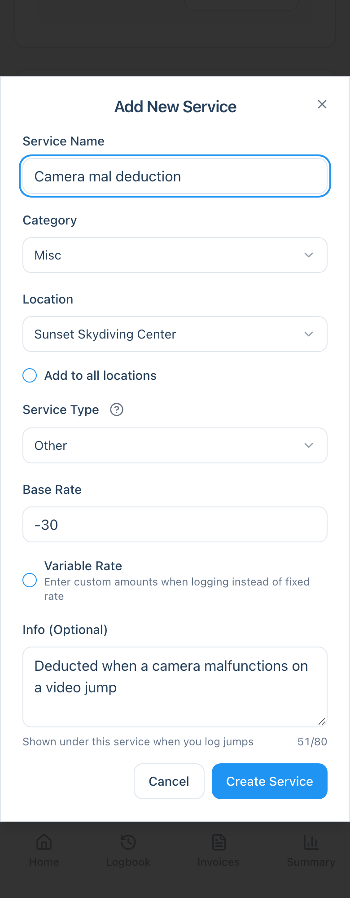
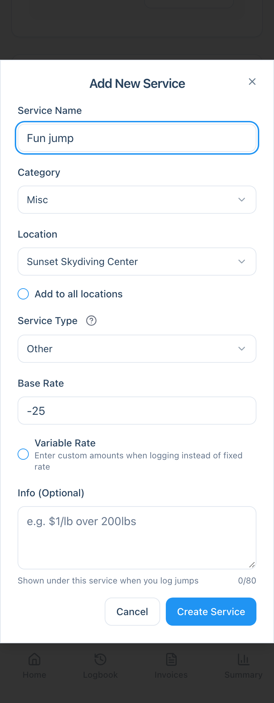
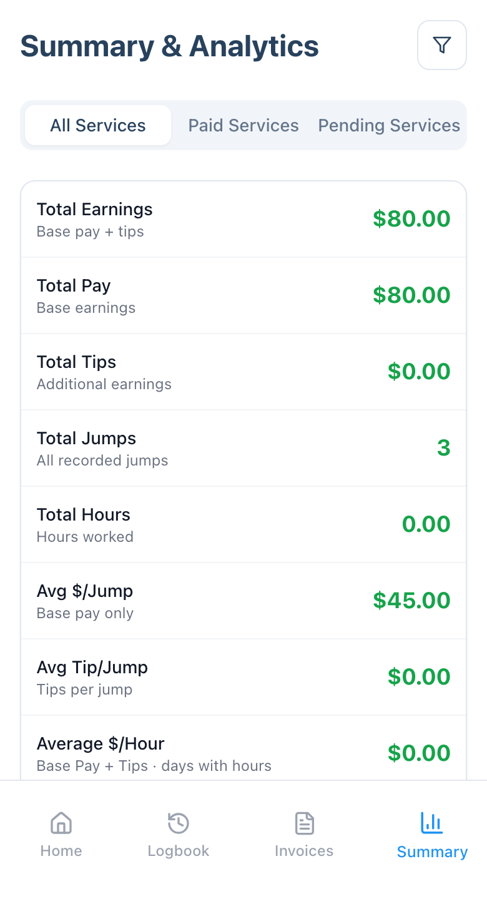

Does your dropzone take fun jumps, camera malfunction deductions or other charges out of your pay? This case study shows how to record them as negative amounts so your earnings reflect what you actually take home, without distorting your jump statistics.

**The scenario:** a tandem instructor whose dropzone deducts $25 for each fun jump and $10 whenever a camera malfunctions on a video jump. They want those amounts on the same day as the work they came out of.

## The idea

A deduction is just a service with a **negative rate**. You set it up once, then log it like any other service. Two settings make it work:

- **A negative Base Rate** (for example `-25`) subtracts the amount from your day's total.
- **Correrctly classifying the Service Type** for pay or post-pay deductions. 

## Scenario 1: Adding and recording pay deductions

You only do this once per location.

1. Add a new **Category** for `Deductions`.
2. **Add New Service**, setting the **Service Name** to `Camera Mal` or whatever the deduction is.
3. Set **Service Type** to `Jump Modifier` if it will impact your jump pay averages, or `Other` to keep it from impacting your jump pay averages in your summary stats.
4. Set **Base Rate** to the amount your dropzone deducts, as a negative number, here it's a **Camera mal deduction** at `-30`.
5. Finish setting up and **Create Service**.

Repeat the steps for anything else that gets deducted. 

## Scenario 2: Adding and recording post-pay deductions.

You only do this once per location.

1. Add a new **Category** for `Misc`.
2. **Add New Service**, setting the **Service Name** to `Fun Jump`.
3. Set **Service Type** to `Other` to keep it from impacting your jump pay averages in your summary stats.
4. Set **Base Rate** to the amount your dropzone deducts, as a negative number, such as `-25`, or leave it as zero if it's not taken as a deduction.
5. Finish setting up and **Create Service**.

## What it does to your numbers

On the **Summary** page, filtered to this one day:

- **Total Earnings** is $80. The deductions reduce it, because that's what you took home.
- **Total Jumps** is 3, and **Avg $/Jump** is $45. Neither is affected, since the deductions are type **Other**.
- If you log start and end times, your **Average $/Hour** also reflects the deductions, because it's based on your total earnings for the day.

## Tips

- Keep deductions in their own category, like `Misc`, so they stay grouped together and away from your paid services.
- Name each deduction after the rule that causes it. It makes your Logbook easy to read when you look back.
