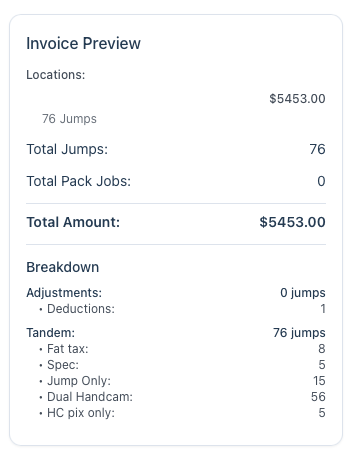
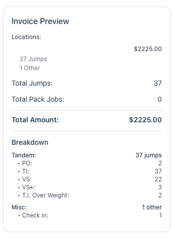

Before you log your first day, it helps to set up how your work is organized. JumpTracker Pro uses two layers, **categories** and **services**, and the names you choose show up everywhere you log. This guide explains how the two fit together and how to name them so they stay easy to scan.

## Categories and services

- A **category** is a heading that groups related work, such as `Tandem`, `Outside Video` or `AFF`.
- A **service** is the specific thing you get paid for under that heading, such as `Jump Only`, `Dual Handcam` or `Pics & Video`. Each service has its own rate.

When you log a day, you tap **+** next to a *service*. The *category* is only the label above it:

| Category | Services under it |
|---|---|
| **Tandem** | Jump Only, Single Handcam, Dual Handcam |
| **Outside Video** | Pics Only, Pics & Video |
| **AFF** | Main, Reserve |
| **Pack Jobs** | Tandem Main, Sport Main, Tandem Reserve, Sport Reserve |

Categories never carry a rate and are never logged on their own. They exist to keep a long list of services organized.

## What you start with

When you add a location, JumpTracker Pro creates four starter categories for it: **Tandem**, **Outside Video**, **AFF** and **Coach**. Each comes with a few example services and rates. They're a starting point. Rename them, change the rates or delete what you don't use.

Categories belong to a single location. If you work at more than one dropzone, each one has its own set.

## Add a category

1. Open **Settings** and go to **Services & Categories**.
2. Tap **+ Category** (it shows as **Cat** on small screens).
3. Type a **Category Name** and tap **Create**.

:::note
**Stay consistent.** Top-level categories help keep your reporting clear when you run invoices. Even if you don't need to invoice a dropzone, they're useful when you want a breakdown of your jump numbers for a certain period.
:::

## Adding your services

The new category is empty until you add a service to it. To do that:

1. Still in **Settings**, tap **+ Service**.
2. Type a **Service Name**, then choose the related category in the **Category** field.
3. Fill in the remaining details, paying special attention to the **Service Type**.

See [Logging Fun Jumps or Other Deductions](/case-studies/log-fun-jumps-and-deductions/) for another example of setting up a service.

### A note on setting up services

There are two approaches to naming services. One is to match how the dropzone pays and classifies them, so you can easily cross-reference the two. The other is to name them exactly how you want to see them reported.

Tandem services are typically the most ambiguous to set up. Here is how the same Tandem work can look on an invoice, depending on how the services are set up.

**Handcams as jumps.** Jump Only, Dual Handcam and HC pix only are each set to the **Jump** service type, so each handcam option is counted as its own jump. Fat tax and Spec are modifiers, so they appear in the breakdown without adding to the count. The Tandem total of 76 jumps is the sum of the three jump services (15 + 56 + 5).

**Handcams as modifiers.** Here the services use the dropzone's own abbreviations. Only TI is set to the **Jump** service type, and PO, VS, VS+ and T.I. Over Weight are **Jump Modifiers** that are logged along with it. The Tandem total of 37 jumps matches the TI count exactly.

When naming your services, consider a few things:

1. Setting the right **Service Type** on each service keeps your counts clear whichever naming approach you choose.
2. If you need to send an invoice with a breakdown, you'll likely want to follow the dropzone's convention.

:::note
**Restructuring a dropzone.** If you ever want to change how a dropzone is reported, you can start from scratch by adding it as a new location and archiving the old one by appending " - Archive 2024-2026" or similar to its name. You can also do this if the dropzone completely restructures how it pays for services.
:::

## Put them in the order you use them

Each row has a drag handle on the left. Drag a category up or down to reorder it, and drag services within a category the same way. Services can only be reordered inside their own category.

That order is what you see on the **Log Day** and **Log Single** forms, so put the work you do most at the top and you'll scroll less.

## Naming that stays clear

A few habits make the lists much easier to read.

**Name the category for the kind of work, and the service for the variation.** Think of the category as the question "what kind of job was this?" and the service as "which version of it?"

**Don't repeat the category in the service name.** The category is always shown above the service, so `Tandem` / `Dual Handcam` reads better than `Tandem` / `Tandem Dual Handcam`.

**Keep names short.** Names have to fit on a phone screen, next to the **+** and **−** buttons. Put longer reminders, such as pay rates for variable services or general descriptions, in the service's **Info** field. It displays under the service whenever you log it.

**Use the same names at every location.** When you add a service with **Add to all locations**, JumpTracker Pro puts it in the category with the *same name* at each location. `Tandem` and `Tandems` count as different categories, so a mismatch can leave a location without the service. Matching names also keep your records consistent when you compare locations.

## Categories don't decide what counts as a jump

This is the most common point of confusion. A category is only a label. Whether a service counts as a jump, a pack job or something else is decided by its **Service Type** (**Jump**, **Jump Modifier**, **Pack Jobs** or **Other**), which you choose when you create the service.

So a service in a category called `Jumps` doesn't count as a jump unless its type is **Jump**, and a service in `Tandem` that is set to **Other** won't be counted as one. If a number on your dashboard looks off, check the service's type first. [How Jump Counts and Totals Are Calculated](/technical/how-totals-are-calculated/) covers each type in detail.

## A good first setup

1. Open **Settings** and make sure your location is added.
2. Delete any starter categories you'll never use, and rename the rest to match how your dropzone talks.
3. Add or edit services so each one has the right **Service Type** and **Base Rate**.
4. Drag categories and services into the order you use them.
5. Log a test day with **Log Day** and check that the list reads the way you expect. See [Dashboard and Logging](/start/dashboard-and-logging/) for a tour of the form.

You can change names, rates and order at any time without losing your logged days.
